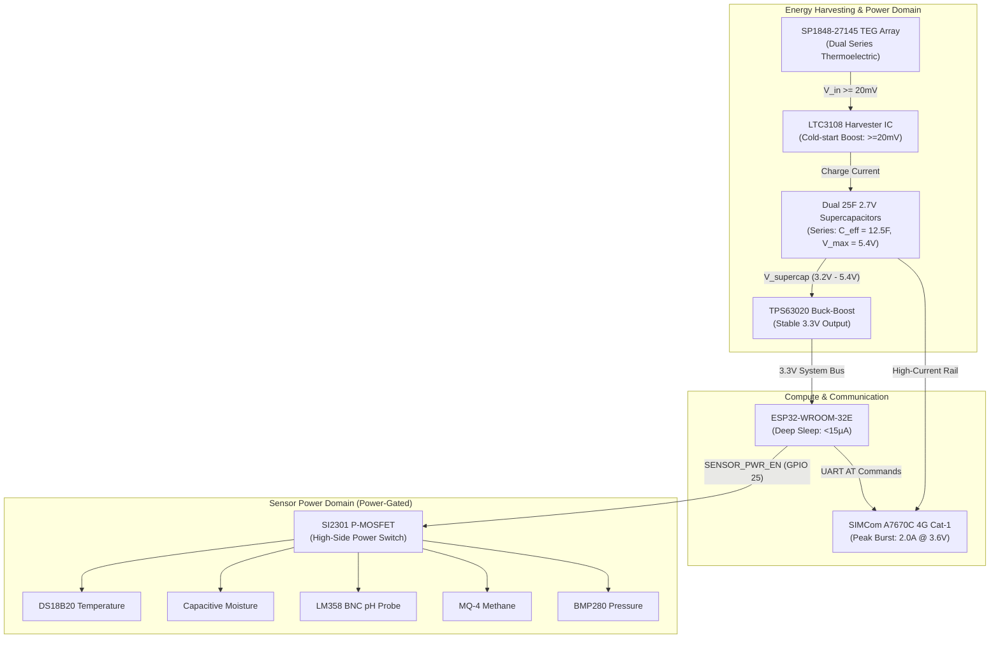

# 🔌 Prithvi Grid — Hardware & Firmware Engineering Specification (v2.0)

> **Document Classification:** Engineering Specification | **Status:** APPROVED  
> **Target Hardware:** Smart Spear Probe Revision B (`REV_B_ESP32_A7670C`)  
> **Authors:** Principal IoT & Systems Architect  
> **Effective Date:** October 2026  

---

## 1. System Architecture & Operating Envelope

The **Smart Spear** is an enterprise-grade, sub-surface agro-industrial telemetry probe engineered to operate inside high-temperature thermophilic compost pits without consumable chemical batteries. It operates entirely on energy harvested from the temperature differential between the hot compost core ($50^\circ\text{C}$ to $65^\circ\text{C}$) and the ambient air.



---

## 2. Electrical Energy Budget & Supercapacitor Dynamics

### 2.1 Storage Specifications
* **Capacitor Topology:** Two 25 Farad, 2.7 Volt rated electric double-layer capacitors (EDLC) in series with passive balancing resistors ($100\text{ k}\Omega$).
* **Effective Capacitance:** $C_{\text{eff}} = 12.5\text{ Farads}$.
* **Maximum Safe Operating Voltage ($V_{\text{max}}$):** $5.4\text{ Volts}$.
* **Operating Cutoff Voltage ($V_{\text{cutoff}}$):** $3.2\text{ Volts}$.
* **Hardware Brownout Reset Threshold ($V_{\text{brownout}}$):** $3.0\text{ Volts}$.

### 2.2 Usable Energy Calculation
$$\Delta E = \frac{1}{2} C_{\text{eff}} \left( V_{\text{max}}^2 - V_{\text{cutoff}}^2 \right) = \frac{1}{2} (12.5) \left( 5.4^2 - 3.2^2 \right) = 6.25 \times (29.16 - 10.24) = 118.25\text{ Joules}$$

### 2.3 Duty Cycle Energy Accounting
| Phase | Duration | Current Draw | Voltage | Energy Consumed |
|---|---|---|---|---|
| **Deep Sleep (2 Hours)** | $7,200\text{ s}$ | $18\,\mu\text{A}$ | $3.3\text{ V}$ | $0.43\text{ J}$ |
| **Sensor Power-Up & Stabilization** | $1.2\text{ s}$ | $45\text{ mA}$ | $3.3\text{ V}$ | $0.18\text{ J}$ |
| **Modem Power-On & 4G Attach** | $4.5\text{ s}$ | $180\text{ mA}$ (avg) | $3.8\text{ V}$ | $3.08\text{ J}$ |
| **TLS Negotiation & HTTP POST Burst** | $1.8\text{ s}$ | $1.4\text{ A}$ (peaks 2A) | $3.6\text{ V}$ | $9.07\text{ J}$ |
| **Total Transmission Cycle** | **~7.5 s** | — | — | **~12.76 Joules** |

> [!IMPORTANT]
> **Voltage Transmission Interlock:**
> Firmware MUST measure $V_{\text{supercap}}$ via `ADC1_CH0` before asserting modem power (`MODEM_PWR_KEY`).
> * If $V_{\text{supercap}} < 4.0\text{ V}$, radio power-up is **STRICTLY PROHIBITED**. The node must buffer sensor readings to SPIFFS and enter deep sleep for an additional 60 minutes to accumulate energy.
> * If $V_{\text{supercap}} \ge 4.0\text{ V}$, proceed with cellular transmission.

---

## 3. Sensor Power-Gating & Warm-Up Sequence

To eliminate phantom leakage currents during the 2-hour sleep window, all sensors are completely isolated via a high-side P-channel MOSFET (`SI2301CDS`, $R_{\text{DS(on)}} \le 75\text{ m}\Omega$).

```
Timeline (milliseconds):
0ms               500ms         750ms         1000ms        1200ms
|-------------------|-------------|-------------|-------------|
GPIO 25 LOW        LM358/BMP280   DS18B20       ADC Read      GPIO 25 HIGH
(MOSFET ON)        Stabilized     Conversion    Complete      (MOSFET OFF)
```

### Firmware Sequencing Steps:
1. **Assert Power Gate:** Set `GPIO 25` to `OUTPUT` and write `LOW` (enables P-MOSFET).
2. **Analog Stabilization Wait:** Delay $500\text{ ms}$ for the LM358 pH op-amp reference voltage and capacitive moisture oscillator to stabilize.
3. **1-Wire Temperature Conversion:** Issue `0x44` (Convert T) to DS18B20; wait $750\text{ ms}$ for 12-bit conversion.
4. **Acquire Samples:**
   - pH: Read 16 samples via `ADC1_CH3` over $50\text{ ms}$; discard min/max and compute trimmed mean.
   - Moisture: Read `ADC1_CH4` (frequency-to-voltage).
   - Pressure: Query BMP280 over I2C (`0x76`); read temperature and uncompensated barometric pressure.
   - Supercapacitor Voltage: Read resistor divider ($1\text{ M}\Omega / 330\text{ k}\Omega$) on `ADC1_CH0`.
5. **De-assert Power Gate:** Write `HIGH` to `GPIO 25` to immediately cut all sensor power.

---

## 4. Cryptographic Telemetry Payload Contract

Every payload sent to `https://api.prithvigrid.com/api/v1/telemetry/ingest` must be authenticated using **HMAC-SHA256**.

### 4.1 Canonical JSON Format
```json
{
  "nodeId": "6716a1b2c3d4e5f678901234",
  "timestamp": "2026-10-23T12:00:00.000Z",
  "tempC": 58.4,
  "moisturePct": 48.2,
  "ph": 6.85,
  "methanePpm": 120,
  "airPressureHpa": 1012.4,
  "batteryMv": 4950,
  "vDropBurstMv": 160,
  "tegDeltaTC": 26,
  "signalRssi": -76,
  "firmwareVersion": "v2.0.1",
  "ackedCommands": ["cmd_101", "cmd_102"]
}
```

### 4.2 HTTP Headers
```http
POST /api/v1/telemetry/ingest HTTP/1.1
Host: api.prithvigrid.com
Content-Type: application/json
X-Device-Id: 6716a1b2c3d4e5f678901234
X-Timestamp: 1792756800
X-Nonce: a8f93e1b7c2d4e5f
X-HMAC-Signature: 8f4a3c2e1b...64_hex_characters
```

$$\text{HMAC-Signature} = \text{HMAC-SHA256}\left(\text{DeviceSecret}, \text{CanonicalBody} + \text{X-Timestamp} + \text{X-Nonce}\right)$$

---

## 5. Piggybacked Command Execution & Wake-Up Lifecycle

The Smart Spear sleeps for $99.9\%$ of its operational life. The cloud backend cannot initiate an inbound socket or push notification to the node.

All downlinks from the cloud occur exclusively via **Command Piggybacking** returned in the `HTTP 202 Accepted` response from the ingestion endpoint:

```json
{
  "success": true,
  "queued": true,
  "commands": [
    {
      "id": "6716f982...",
      "command": "SET_BURST_INTERVAL",
      "payload": { "intervalSeconds": 14400 }
    },
    {
      "id": "6716f985...",
      "command": "OTA_TRIGGER",
      "payload": {
        "targetVersion": "v2.1.0",
        "binaryUrl": "https://firmware.prithvigrid.com/esp32/v2.1.0.bin",
        "sha256": "e3b0c44298fc1c149afbf4c8996fb...",
        "fileSizeBytes": 1450000,
        "chunkSizeBytes": 4096
      }
    }
  ]
}
```

### Supported Remote Command Handlers:
1. `BUZZER_MUTE`: Deactivates onboard piezo buzzer pin `GPIO 19`.
2. `LED_STROBE`: Flashes external beacon on junction box for 10 seconds for field location by Safai Mitras.
3. `SET_BURST_INTERVAL`: Updates deep sleep timer (e.g. adjust from 2 hours to 4 hours in winter cold pits).
4. `REBOOT`: Performs a clean software restart via `esp_restart()`.
5. `OTA_TRIGGER`: Initiates staged chunked OTA update.

---

## 6. Dual-OTA Partition Scheme & Safe Bootloader Rollback

### 6.1 ESP32 Flash Partition Table (`partitions.csv`)
```csv
# Name,   Type, SubType, Offset,   Size,     Flags
nvs,      data, nvs,     0x9000,   0x5000,
otadata,  data, ota,     0xe000,   0x2000,
app0,     app,  ota_0,   0x10000,  0x1C0000,
app1,     app,  ota_1,   0x1D0000, 0x1C0000,
spiffs,   data, spiffs,  0x390000, 0x60000,
```

### 6.2 Pre-OTA Safety Checklist
Firmware MUST execute the following checks before downloading the first byte:
1. **Supercapacitor Voltage Gate:** $V_{\text{supercap}} \ge 4,800\text{ mV}$. If below, abort and wait for thermal harvesting.
2. **Cellular Signal Gate:** $\text{RSSI} \ge -85\text{ dBm}$.
3. **Partition Verification:** Determine target inactive partition (`ota_0` vs `ota_1`).

### 6.3 Chunked Download & Integrity Verification
1. Download in **4,096 byte chunks** using HTTP Range requests (`Range: bytes=0-4095`).
2. Write each chunk to flash partition via `esp_ota_write()`.
3. Compute running SHA-256 hash. Compare with `sha256` payload parameter.
4. If hash does not match, erase partition and DO NOT set boot partition.
5. If valid, call `esp_ota_set_boot_partition()`.

### 6.4 Automatic Rollback & Hardware Watchdog
```c
// At start of app_main() in new firmware:
esp_ota_img_states_t ota_state;
esp_ota_get_state_partition(esp_ota_get_running_partition(), &ota_state);

if (ota_state == ESP_OTA_IMG_PENDING_VERIFY) {
    // Start 60-second safety watchdog
    init_watchdog(60);
    
    // Attempt network connection and self-test
    if (perform_hardware_self_test() && test_cloud_ping()) {
        // Successful verification! Mark app valid permanently
        esp_ota_mark_app_valid_cancel_rollback();
        ESP_LOGI("OTA", "Firmware verified and marked valid.");
    } else {
        // Test failed! Revert to previous working partition
        ESP_LOGE("OTA", "Self-test failed. Triggering automatic rollback.");
        esp_ota_mark_app_invalid_rollback_and_reboot();
    }
}
```

---

## 7. Factory Provisioning NVS Data Structure

During manufacturing, the factory operator flashes the following keys into the `nvs` partition:

| Key Name | Type | Description |
|---|---|---|
| `prithvi.nodeId` | string | 24-character MongoDB ObjectId |
| `prithvi.assetCd` | string | Unique asset tag (`PG-SPEAR-XXXX`) |
| `prithvi.mac` | string | Factory MAC address |
| `prithvi.secret` | hex string | 256-bit cryptographically secure device secret |
| `prithvi.endpoint`| string | Canonical API URL (`https://api.prithvigrid.com`) |
| `prithvi.interval`| uint16 | Default deep sleep interval in seconds (7200) |
| `prithvi.hwrev` | string | Hardware revision identifier (`REV_B_ESP32_A7670C`) |

---

## 8. Summary of Firmware Constants & Pinout

```c
#define PIN_SENSOR_PWR_EN     25  // High-side P-MOSFET gate
#define PIN_ONE_WIRE_BUS       4  // DS18B20 data line with 4.7k pullup
#define PIN_ADC_MOISTURE      34  // Capacitive moisture analog input
#define PIN_ADC_PH            35  // LM358 op-amp pH analog input
#define PIN_ADC_SUPERCAP      36  // Voltage divider (1M / 330k)
#define PIN_I2C_SDA           21  // BMP280 SDA
#define PIN_I2C_SCL           22  // BMP280 SCL
#define PIN_MODEM_TX          17  // ESP32 TX -> A7670C RX
#define PIN_MODEM_RX          16  // ESP32 RX -> A7670C TX
#define PIN_MODEM_PWR_KEY      5  // A7670C Power key
#define PIN_PIEZO_BUZZER      19  // Piezo alarm buzzer
```

---
*End of Engineering Specification.*
