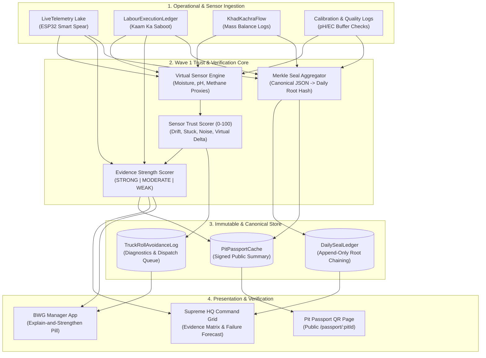

# 🛡️ Prithvi Grid — Agent Build Prompt: Wave 1 (Trust & Signal Foundation)
**Document Classification:** Agent Implementation Specification | **Target:** Wave 1 (Features 5, 6 & 4)  
**System Base:** Prithvi Grid v2.0 Enterprise SaaS & Smart Spear Telemetry Architecture  
**Primary Vertical Focus:** Commercial Hospitality & Hotels (with general BWG compatibility)  
**AI Provider Rule:** Google Gemini Only (perception, draft extraction, narrative phrasing; 0% autonomous decision authority)  

---

## 1. Executive Summary & Objective

Wave 1 constructs the unassailable trust, signal integrity, and verification bedrock for the entire Prithvi Grid platform. Today, compliance PDFs and sensor charts can be contested by municipal inspectors or hospital/hotel risk officers on the grounds that database records might have been altered post-facto, or that uncalibrated/degraded sensors produce false compliance comforts. 

This build delivers:
1. **Feature 5 (Merkle Evidence Chain & Pit Passport QR):** Cryptographic daily tenant seals, SHA-256 Merkle tree verification, inclusion proofs for every cited data point, non-destructive amendment logs, and a public, mobile-responsive Pit Passport QR interface (`/passport/:pitId`).
2. **Feature 6 (Evidence Strength Score):** A deterministic multi-factor scoring engine (`STRONG`, `MODERATE`, `WEAK`) covering coverage, sensor trust, corroboration, freshness, manager attestation, and provenance, with versioned configuration tagged `LEGAL-REVIEW` and Gemini-generated plain-language remediation steps.
3. **Feature 4 (Virtual Sensors & Sensor Trust Score):** Physics- and biology-informed virtual sensor estimators (Moisture, pH-risk, Methane proxy) with explicit `ESTIMATED` branding, per-probe Sensor Trust Scores (0–100), automated engine down-weighting, and a four-stage Truck-Roll Avoidance workflow before technician dispatch.

---

## 2. Architecture & Data Flow



---

## 3. Data Models & Schemas

The following Mongoose models must be created or augmented in `packages/api/src/db/models/`.

### 3.1 `DailySealLedger.ts`
Appends immutable cryptographic day-roots chained across consecutive operational dates per tenant.
```typescript
import { Schema, model, Document, Types } from 'mongoose';

export interface IMerkleLeafRecord {
  recordType: 'TELEMETRY' | 'LABOUR_CLAIM' | 'MANAGER_OVERRIDE' | 'CALIBRATION' | 'WEIGHT_LOG' | 'DOCUMENT';
  recordId: Types.ObjectId;
  canonicalHash: string; // SHA-256 of canonical JSON
  timestamp: Date;
}

export interface IDailySealLedger extends Document {
  tenantId: Types.ObjectId;
  facilityId: Types.ObjectId;
  sealDate: string; // YYYY-MM-DD
  merkleRoot: string; // 64-char hex SHA-256
  previousSealHash: string; // Chained parent seal hash
  leafCount: number;
  leaves: IMerkleLeafRecord[];
  isAmended: boolean;
  amendmentCount: number;
  externalAnchorId?: string; // Optional external RFC 3161 / TSA receipt
  sealedAt: Date;
  status: 'SEALED' | 'AMENDED_AFTER_SEAL';
}

const MerkleLeafSchema = new Schema<IMerkleLeafRecord>({
  recordType: { type: String, required: true },
  recordId: { type: Schema.Types.ObjectId, required: true },
  canonicalHash: { type: String, required: true, length: 64 },
  timestamp: { type: Date, required: true }
}, { _id: false });

export const DailySealLedgerSchema = new Schema<IDailySealLedger>({
  tenantId: { type: Schema.Types.ObjectId, ref: 'GlobalEntity', required: true, index: true },
  facilityId: { type: Schema.Types.ObjectId, ref: 'FacilityLocation', required: true, index: true },
  sealDate: { type: String, required: true },
  merkleRoot: { type: String, required: true, length: 64 },
  previousSealHash: { type: String, required: true, length: 64 },
  leafCount: { type: Number, required: true, min: 0 },
  leaves: [MerkleLeafSchema],
  isAmended: { type: Boolean, default: false },
  amendmentCount: { type: Number, default: 0 },
  externalAnchorId: { type: String },
  sealedAt: { type: Date, default: Date.now },
  status: { type: String, enum: ['SEALED', 'AMENDED_AFTER_SEAL'], default: 'SEALED' }
}, { timestamps: true });

DailySealLedgerSchema.index({ tenantId: 1, facilityId: 1, sealDate: 1 }, { unique: true });
export const DailySealLedger = model<IDailySealLedger>('DailySealLedger', DailySealLedgerSchema);
```

### 3.2 `SensorTrustScore.ts`
Maintains operational trust assessments and virtual sensor correlations per physical probe.
```typescript
import { Schema, model, Document, Types } from 'mongoose';

export interface ISensorHealthMetrics {
  sensorType: 'TEMPERATURE' | 'MOISTURE' | 'PH' | 'METHANE' | 'PRESSURE';
  trustScore: number; // 0 to 100
  calibrationAgeDays: number;
  driftPpmOrUnit: number;
  stuckSignalFlag: boolean;
  noiseLevelPct: number;
  virtualSensorDivergencePct: number;
  status: 'HEALTHY' | 'DEGRADED' | 'FAILED' | 'REPLACED';
}

export interface ISensorTrustRecord extends Document {
  nodeId: Types.ObjectId;
  pitId: Types.ObjectId;
  facilityId: Types.ObjectId;
  assessedAt: Date;
  overallNodeTrustScore: number; // 0 to 100
  sensorMetrics: ISensorHealthMetrics[];
  failureForecastDays?: number; // Estimated days until critical failure
  recommendedAction?: 'NO_ACTION' | 'FORCE_READ' | 'REMOTE_CALIBRATION' | 'BUZZER_TEST' | 'DISPATCH_FIELD_VISIT';
}

export const SensorTrustRecordSchema = new Schema<ISensorTrustRecord>({
  nodeId: { type: Schema.Types.ObjectId, ref: 'PhysicalAsset', required: true, index: true },
  pitId: { type: Schema.Types.ObjectId, ref: 'PhysicalAsset', required: true, index: true },
  facilityId: { type: Schema.Types.ObjectId, ref: 'FacilityLocation', required: true, index: true },
  assessedAt: { type: Date, default: Date.now, index: true },
  overallNodeTrustScore: { type: Number, required: true, min: 0, max: 100 },
  sensorMetrics: [{
    sensorType: { type: String, required: true },
    trustScore: { type: Number, required: true, min: 0, max: 100 },
    calibrationAgeDays: { type: Number, required: true },
    driftPpmOrUnit: { type: Number, default: 0 },
    stuckSignalFlag: { type: Boolean, default: false },
    noiseLevelPct: { type: Number, default: 0 },
    virtualSensorDivergencePct: { type: Number, default: 0 },
    status: { type: String, enum: ['HEALTHY', 'DEGRADED', 'FAILED', 'REPLACED'], default: 'HEALTHY' }
  }],
  failureForecastDays: { type: Number },
  recommendedAction: { 
    type: String, 
    enum: ['NO_ACTION', 'FORCE_READ', 'REMOTE_CALIBRATION', 'BUZZER_TEST', 'DISPATCH_FIELD_VISIT'],
    default: 'NO_ACTION'
  }
}, { timestamps: true });

export const SensorTrustRecord = model<ISensorTrustRecord>('SensorTrustRecord', SensorTrustRecordSchema);
```

---

## 4. Algorithmic Specifications

### 4.1 Feature 5: Merkle Tree Construction & Canonical Hashing
1. **Canonical JSON Serialization:**  
   Every object is recursively key-sorted and whitespace-stripped:
   $$\text{Canonical}(O) = \text{JSON.stringify}(O, \text{Object.keys}(O).\text{sort}())$$
2. **Leaf Generation:**  
   Each transaction $R_i$ produces $H(R_i) = \text{SHA256}(\text{Canonical}(R_i))$.
3. **Binary Tree Reduction:**  
   Pairs of adjacent node hashes $H_a, H_b$ are concatenated and hashed: $H_{parent} = \text{SHA256}(H_a \parallel H_b)$. If the list count is odd, the last leaf hash is duplicated.
4. **Daily Seal Linkage:**
   $$\text{SealHash}_d = \text{SHA256}\left(\text{TenantId} \parallel \text{SealDate} \parallel \text{MerkleRoot}_d \parallel \text{SealHash}_{d-1}\right)$$
5. **Non-Destructive Amendments:**  
   If a historical record is edited post-seal via the Supreme HQ Data Grid, it does NOT overwrite the original leaf. A new transaction is created with `recordType: 'MANAGER_OVERRIDE'` referencing `originalLeafHash`, sealed in the current day's root, marking the historical document badge as **Amended After Sealing** with the auditable amendment note.

### 4.2 Feature 6: Evidence Strength Score Formulation
> [!IMPORTANT]
> **LEGAL-REVIEW Configuration:** The weightings below are versioned and cannot be bypassed at runtime.

The deterministic Evidence Strength Score ($S_{\text{evidence}} \in [0, 100]$) is computed as:
$$S_{\text{evidence}} = w_c \cdot C + w_t \cdot T + w_k \cdot K + w_f \cdot F + w_a \cdot A - P_{amend}$$
Where:
- $C$ (Coverage %): $\frac{\text{Actual Sensor Readings}}{\text{Expected Baseline Readings}} \times 100$ ($w_c = 0.25$)
- $T$ (Sensor Trust %): Average `SensorTrustScore` of active probes for the metric ($w_t = 0.25$)
- $K$ (Corroboration %): Agreement between independent sensors or between physical and virtual sensors ($w_k = 0.20$)
- $F$ (Freshness %): Decay score based on hours elapsed since last verified telemetry ($w_f = 0.15$)
- $A$ (Human Attestation %): 100 if verified by supervisor photo/signoff, 50 if Safai Mitra voice-log, 0 if unverified ($w_a = 0.15$)
- $P_{amend}$ (Provenance Penalty): 15 points deducted if any underlying record was amended post-seal.

**Classification Thresholds:**
- **STRONG:** $S_{\text{evidence}} \ge 80$
- **MODERATE:** $55 \le S_{\text{evidence}} < 80$
- **WEAK:** $S_{\text{evidence}} < 55$

For every claim rated `MODERATE` or `WEAK`, code generates structured gap items:
```json
{
  "gapCategory": "CALIBRATION_OVERDUE",
  "sensor": "PH_PROBE",
  "impactPoints": -18,
  "remediationKey": "RECALIBRATE_PH_BUFFER_7"
}
```
Gemini is passed this structured gap array to output a concise, actionable, single-sentence Hindi or English remediation tip (e.g., *"pH probe ko buffer 7 mein calibrate karein taaki evidence rating Strong ho sake"*).

### 4.3 Feature 4: Virtual Sensors & Truck-Roll Avoidance
1. **Virtual Moisture Estimator:**
   Calculates expected moisture retention curve based on thermophilic evaporation and historical pit watering:
   $$M_{\text{virt}}(t) = M(t_0) \cdot e^{-\lambda(T_{\text{core}}, T_{\text{ambient}}) \cdot \Delta t} + \sum \Delta M_{\text{watered}}$$
2. **Virtual pH Acid-Crash Proxy:**
   If temperature drops rapidly ($\Delta T < -4^\circ\text{C}/\text{hr}$) while methane rises ($\Delta \text{CH}_4 > 30\text{ ppm}/\text{hr}$) within 48 hours of loading fresh oily hotel food waste, virtual pH risk predicts an imminent acid drop ($pH_{\text{virt}} \le 5.2$).
3. **Virtual Methane & Aeration Proxy:**
   Infers bed compaction and anaerobic pocket formation from static barometric differentials and temperature decay half-life.
4. **Honesty & Safeguards:**
   - Virtual estimates are flagged `isEstimated: true`.
   - Virtual values **NEVER** overwrite physical telemetry in `LiveTelemetry`.
   - Virtual values **CANNOT** be the sole evidence to declare a `FAKE` verdict or trigger municipal compliance penalties.
5. **Truck-Roll Avoidance Engine:**
   Before scheduling a field service technician (costing ₹750/visit), the system automatically attempts:
   - **Step 1 (Remote Diagnostics):** Schedule dense sampling burst on next wake appointment.
   - **Step 2 (Self-Cleaning / Calib-Check):** Instruct node via piggyback command to run high-voltage ADC stabilization or buzzer pulse test.
   - **Step 3 (Ground Assist):** Prompt Safai Mitra via PWA to visually inspect probe cable or rinse sensor shroud with water during morning shift.
   - **Step 4 (Batched Dispatch):** Only if Steps 1–3 fail and score remains $< 40$ for 72 hours, queue dispatch bundled with other facilities in the same IMC zone.

---

## 5. API Contracts & Endpoints

All new endpoints adhere to existing bearer JWT authentication and multi-tenant scoping, except the public Pit Passport.

### 5.1 Public Pit Passport
- **Endpoint:** `GET /api/v1/passport/:pitId`
- **Auth:** Public (No token required; strictly non-PII)
- **Response `200 OK`:**
```json
{
  "success": true,
  "data": {
    "pitIdentifier": "PG-PIT-IND-042",
    "facilityName": "Radisson Blu Indore - Organic Composting Facility",
    "currentStatus": "HEALTHY_THERMOPHILIC",
    "thirtyDayHealthPct": 96.4,
    "verifiedTasksCount": 84,
    "lastCalibratedAt": "2026-10-18T10:30:00.000Z",
    "sealStatus": "SEALED_VERIFIED",
    "dailySealHash": "e3b0c44298fc1c149afbf4c8996fb92427ae41e4649b934ca495991b7852b855",
    "evidenceStrength": "STRONG",
    "disclaimer": "Process monitoring summary generated by Prithvi Grid. Does not substitute certified third-party laboratory NPK/heavy-metal assays."
  }
}
```

### 5.2 Daily Seal Inclusion Verification
- **Endpoint:** `POST /api/v1/compliance/verify-record-inclusion`
- **Auth:** Bearer JWT (Auditor, Manager, Supreme Head)
- **Request:**
```json
{
  "facilityId": "6717a0000000000000000001",
  "sealDate": "2026-10-23",
  "recordType": "LABOUR_CLAIM",
  "recordId": "6718b0000000000000000005",
  "rawPayload": { ... }
}
```
- **Response `200 OK`:**
```json
{
  "success": true,
  "data": {
    "isIncluded": true,
    "merkleRoot": "a7b8c9d0...",
    "inclusionProof": [
      { "position": "right", "hash": "f1e2d3..." },
      { "position": "left", "hash": "c4b5a6..." }
    ],
    "sealTimestamp": "2026-10-23T23:59:59.000Z",
    "isAmended": false
  }
}
```

### 5.3 Sensor Trust & Virtual Estimates
- **Endpoint:** `GET /api/v1/fleet/sensors/trust/:nodeId`
- **Auth:** Bearer JWT (BWG_MANAGER, SUPREME_HEAD)
- **Response `200 OK`:**
```json
{
  "success": true,
  "data": {
    "nodeId": "6716a1b2c3d4e5f678901234",
    "overallTrustScore": 88,
    "probes": [
      {
        "sensorType": "MOISTURE",
        "trustScore": 92,
        "measuredValue": 54.2,
        "virtualEstimate": 52.8,
        "isEstimated": false,
        "status": "HEALTHY"
      },
      {
        "sensorType": "PH",
        "trustScore": 64,
        "measuredValue": 6.8,
        "virtualEstimate": 6.5,
        "calibrationAgeDays": 42,
        "status": "DEGRADED",
        "actionRequired": "BUFFER_RECALIBRATION_DUE"
      }
    ],
    "truckRollAvoidanceStage": "STEP_2_REMOTE_CALIB_PENDING"
  }
}
```

---

## 6. Hotel-Specific Operational Playbook Integration

In hotel hospitality deployments (e.g. Radisson, Marriott, Sayaji Indore):
1. **Banquet Food Waste Surge Robustness:**  
   When greasy banquet waste is added, physical pH and moisture sensors often foul due to fat coatings. Virtual pH and moisture estimators bridge the 12-hour gap while alerting the manager to rinse the probe rather than declaring sensor hardware dead.
2. **Odor Reputation Shield Linkage:**  
   The Evidence Strength Score directly gates the public **Verified Green Badge** in the hotel lobby. If moisture or methane telemetry coverage falls below 75%, the badge automatically fades to `Verification Pending` to prevent greenwashing risk.

---

## 7. Definition of Done & Test Suite

The implementation will be verified through a dedicated test suite in `packages/api/test/phase-8-wave-1-trust-signals.test.ts`:

1. **Deterministic Merkle Construction:** Test verifies that given a set of 10 canonical telemetry and labour records, the identical Merkle root is computed, and single-byte tampering in any leaf changes the root hash.
2. **Daily Chain Linkage:** Verifies that Day 2 seal explicitly links `previousSealHash` from Day 1 seal, forming an unbroken cryptographic chain.
3. **Amendment Auditability:** Verifies that modifying a sealed record generates an auditable amendment event without destroying historical inclusion proofs.
4. **Evidence Strength Math:** Unit tests verify exact mathematical boundary transitions between `STRONG` (>=80), `MODERATE` (55-79), and `WEAK` (<55) claims.
5. **Virtual Sensor Isolation:** Verifies that virtual estimates never overwrite `LiveTelemetry` and cannot unilaterally cause a `FAKE` verdict.
6. **Gemini Language Guard:** Verifies that Gemini produces clean Hindi/English phrasing from structured gap objects and never calculates cryptographic hashes or trust scores autonomously.
